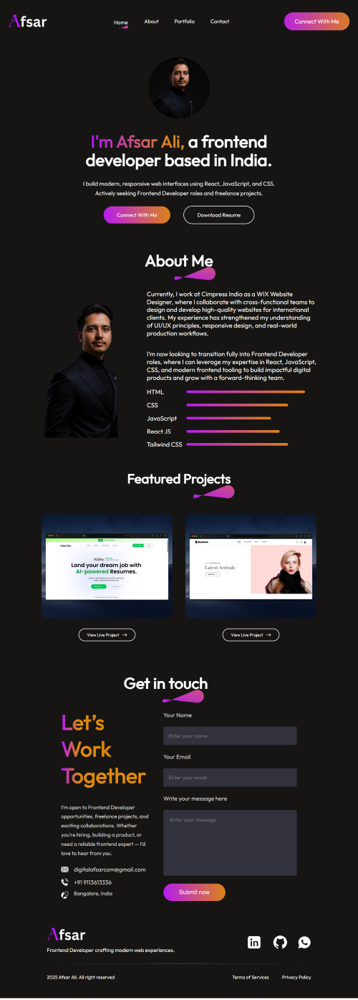

# 🚀 Personal Portfolio Website – Afsar Ali

A modern, fully responsive **Frontend Developer Portfolio Website** built using **React** and **CSS**.  
This portfolio highlights my skills, experience, featured projects, and contact details with a clean and professional UI.

---

## 🌐 Live Demo

- 🌐 **Live Demo: https://portfolio.vercel.app/  
- 📦 **Source Code: https://github.com/AfsarWebDev/portfolio  

---

## 🖼️ Screenshot (Desktop View)

---

## 👋 About Me

Hi, I’m **Afsar Ali**, a frontend developer based in India.

I currently work at **Cimpress India** as a **WIX Website Designer**, collaborating with cross-functional teams to design and deliver high-quality websites for international clients.

I am actively seeking:
- Frontend Developer roles  
- Freelance projects  
- Long-term collaborations  

---

## ✨ Features

- Fully responsive design (Desktop, Tablet, Mobile)
- Smooth scroll navigation
- Modern UI with animations
- Featured projects with live demo links
- Resume download functionality
- Contact form with email integration
- Clean, reusable React components

---

## 🛠️ Tech Stack

- React (Vite)
- JavaScript (ES6+)
- HTML5
- CSS3
- Web3Forms API

---

## 📄 Resume

The **Download Resume** button allows users to download my resume in PDF format.

Resume file location: ./public/preview.png

---

## 📬 Contact

📧 Email: digitalafsarcom@gmail.com  
📞 Phone: +91 9113613336  
📍 Location: Bangalore, India  

---

## 🔗 Social Links

- LinkedIn: https://www.linkedin.com/in/digitalafsar/
- GitHub: https://github.com/AfsarWebDev
- WhatsApp: https://wa.me/919113613336

---

## 🚀 Run Locally

### 1️⃣ Clone the repository
git clone https://github.com/AfsarWebDev/portfolio

### 2️⃣ Go to project folder
cd portfolio

### 3️⃣ Install dependencies
npm install

### 4️⃣ Start dev server
npm run dev

## 📄 License
This project is licensed under the MIT License.